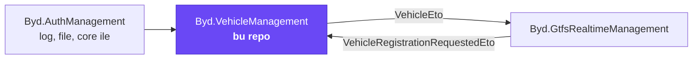
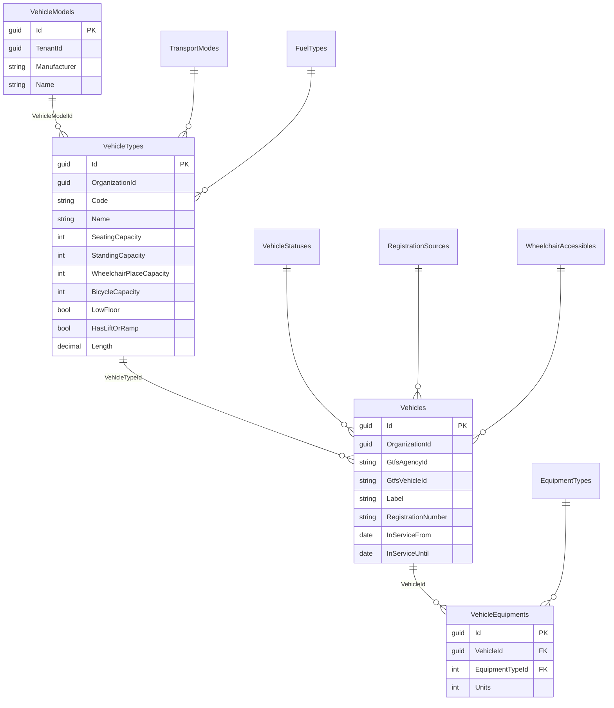
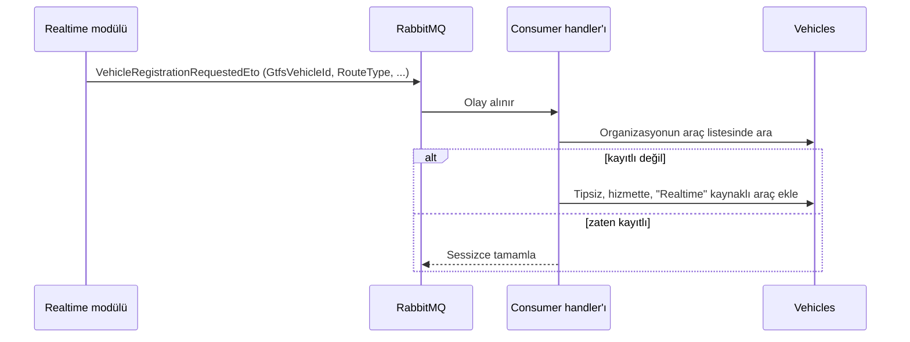

# Byd.VehicleManagement

[](https://www.nuget.org/packages/Byd.VehicleManagement.Domain)


Toplu taşıma filosunun modülü. Araç lookup'larını, üretici modellerini, organizasyona ait araç tiplerini, araçları ve araç
donanımlarını tutar. Araç kimliği GTFS-RT ile uyumludur: canlı akışta görülen bir araç, kayıtlı değilse kendiliğinden
eklenir.

## İçindekiler

- [Platformdaki yeri](#platformdaki-yeri)
- [Bir bakışta](#bir-bakışta)
- [Veri modeli](#veri-modeli)
- [Özellikler](#özellikler)
- [HTTP uçları](#http-uçları)
- [Olaylar](#olaylar)
- [Yetkiler](#yetkiler)
- [Hata kodları](#hata-kodları)
- [Bir modülde kullanmak](#bir-modülde-kullanmak)
- [Geliştirme](#geliştirme)

## Platformdaki yeri



## Bir bakışta

| | |
|---|---|
| Paket ailesi | `Byd.VehicleManagement.*` |
| Sürüm | `0.1.0` (`common.props`) |
| Bağımlılık | `Byd.AuthManagement` 0.1.9, `Byd.LogManagement` 0.1.6 (file ve core onlarla gelir) |
| Veritabanı | PostgreSQL, `vehicle_management` şeması; bağlantı dizesi `VehicleManagement` (yoksa `Default`) |
| Ek paket | `Byd.VehicleManagement.Consumer`: başka modüllerden gelen olayların handler'ları |

## Veri modeli



| Tablo | Kapsam | Ne tutar |
|---|---|---|
| `TransportModes` | Host (lookup) | Ulaşım modu; kodu GTFS `route_type` ile aynıdır |
| `FuelTypes` | Host (lookup) | Yakıt türü |
| `VehicleStatuses` | Host (lookup) | Araç durumu |
| `RegistrationSources` | Host (lookup) | Aracın kaydedildiği kaynak; canlı akıştan gelenler "Realtime" kaynaklıdır |
| `WheelchairAccessibles` | Host (lookup) | GTFS-RT `wheelchair_accessible` değerleri |
| `EquipmentTypes` | Host (lookup) | Donanım türü |
| `VehicleModels` | Tenant | Üretici ve model adı |
| `VehicleTypes` | Organizasyon | Kapasite, alçak taban, rampa, uzunluk; mod ve yakıt türü |
| `Vehicles` | Organizasyon | Araçlar |
| `VehicleEquipments` | Organizasyon | Aracın donanımları ve adetleri |

Lookup'ların varsayılan satırları host açılışında seed edilir.

## Özellikler

### 1. Lookup yönetimi

Altı lookup tek bir taban controller'dan aynı uç kümesini alır: ekleme, tekil okuma, liste, güncelleme ve silme. Lookup
satırı `Id`, `Code` ve `Name` taşır; kod tekildir.

### 2. Kapsam katmanları

| Kayıt | Kim görür |
|---|---|
| Lookup'lar | Herkes (host kapsamı) |
| Üretici modeli | Tenant'taki herkes |
| Araç tipi, araç, donanım | Yalnız kendi organizasyonu |

Organizasyon kapsamı token'dan gelir; organizasyonsuz bir istek araç yazamaz.

### 3. GTFS uyumlu araç kimliği

Aracın kimliği organizasyonda işletmeci (`GtfsAgencyId`) ile birlikte GTFS-RT `vehicle.id` değeridir (`GtfsVehicleId`).
Plaka tekil sayılmaz, kaynaktaki haliyle tutulur. Aracın hizmet aralığı `InServiceFrom` ve `InServiceUntil` ile tutulur.

### 4. Realtime'dan otomatik kayıt

Canlı akışta görülen ama kayıtlı olmayan araç iki yoldan eklenebilir:

| Yol | Nasıl |
|---|---|
| Olay | Realtime modülü `VehicleRegistrationRequestedEto` yayınlar; `Byd.VehicleManagement.Consumer` paketindeki handler aracı olayın kapsamında kaydeder |
| Süreç içi çağrı | `IVehicleAppService.FindOrRegisterRealtimeAsync` (HTTP'ye açılmaz) |



Girdi GTFS standardının değerleriyle gelir: `RouteType` (temel ya da genişletilmiş `route_type`), `wheelchair_accessible`,
`GtfsAgencyId`, `GtfsVehicleId`, `Label` ve `RegistrationNumber`. Aynı olayın tekrar teslimi ikinci bir araç yazmaz.

### 5. Önbellekli araç listesi

Organizasyonun araç listesi önbellekte tutulur ve araç satırı değiştiğinde silinir. Realtime eşlemesi her mesajda
veritabanına gitmez.

### 6. Araç değişikliği olayı

Araç eklendiğinde, güncellendiğinde ya da silindiğinde ABP entity olayı `VehicleEto` ile dağıtık olarak yayınlanır.
Diğer modüller akıştaki GTFS-RT kimliğini araç kaydına bu olayla eşler.

## HTTP uçları

Her kaynak aynı uç kümesini taşır:

| Yöntem | Yol | Ne yapar |
|---|---|---|
| `POST` | `{kaynak}` | Ekler |
| `GET` | `{kaynak}/{id}` | Tek kayıt |
| `GET` | `{kaynak}/filtered-list` | Filtreli, sıralı, sayfalı liste |
| `PUT` | `{kaynak}/{id}` | Günceller |
| `DELETE` | `{kaynak}/{id}` | Siler |

| Kaynak | Kök yol |
|---|---|
| Araçlar | `api/vehicle-management/vehicles` |
| Araç tipleri | `api/vehicle-management/vehicle-types` |
| Üretici modelleri | `api/vehicle-management/vehicle-models` |
| Araç donanımları | `api/vehicle-management/vehicle-equipments` |
| Lookup'lar | `api/vehicle-management/lookups/{transport-modes, fuel-types, vehicle-statuses, wheelchair-accessibles, equipment-types, registration-sources}` (liste için `GET` kökü, kimlik `int`) |

## Olaylar

| Olay | Ad | Yön | Ne zaman |
|---|---|---|---|
| `VehicleEto` | `VehicleManagement.Vehicle` | Bu modül yayınlar | Araç eklenince, güncellenince, silinince; `Id`, `TenantId`, `OrganizationId`, `GtfsAgencyId`, `GtfsVehicleId` |
| `VehicleRegistrationRequestedEto` | `VehicleManagement.Vehicles.RegistrationRequested` | Bu modül dinler | Realtime akışında kayıtsız araç görülünce |

## Yetkiler

| İzin | Ne verir |
|---|---|
| `VehicleManagement.Lookups.View` / `.Manage` | Lookup'ları görmek / yönetmek |
| `VehicleManagement.VehicleModels.View` / `.Manage` | Üretici modelleri |
| `VehicleManagement.VehicleTypes.View` / `.Manage` | Araç tipleri |
| `VehicleManagement.Vehicles.View` / `.Manage` | Araçlar |
| `VehicleManagement.VehicleEquipments.View` / `.Manage` | Araç donanımları |

## Hata kodları

| Aile | Kapsadığı durumlar |
|---|---|
| `VehicleExceptionCodes` | Kapsam yok, mod/durum zorunlu, GTFS kimliği eksik/uzun, hizmet bitişi başlangıçtan önce, tip/durum bulunamadı |
| `VehicleTypeExceptionCodes` | Kod/ad eksik ya da uzun, mod/yakıt zorunlu, geçersiz kapasite ve uzunluk |
| `VehicleModelExceptionCodes` | Tenant zorunlu, üretici/ad eksik ya da uzun |
| `VehicleEquipmentExceptionCodes` | Araç/donanım türü zorunlu ya da bulunamadı, geçersiz adet |
| `VehicleLookupExceptionCodes` | Ad zorunlu, kod geçersiz ya da tekrarlı |

Kodlar `VehicleManagement:` önekiyle gelir.

## Bir modülde kullanmak

| Tüketen katman | Paket | Modül sınıfı |
|---|---|---|
| `<Modül>.Domain.Shared` | `Byd.VehicleManagement.Domain.Shared` | `VehicleManagementDomainSharedModule` |
| `<Modül>.Domain` | `Byd.VehicleManagement.Domain` | `VehicleManagementDomainModule` |
| `<Modül>.Application.Contracts` | `Byd.VehicleManagement.Application.Contracts` | `VehicleManagementApplicationContractsModule` |
| `<Modül>.Application` | `Byd.VehicleManagement.Application` | `VehicleManagementApplicationModule` |
| `<Modül>.EntityFrameworkCore` | `Byd.VehicleManagement.EntityFrameworkCore` | `VehicleManagementEntityFrameworkCoreModule` |
| `<Modül>.HttpApi` | `Byd.VehicleManagement.HttpApi` | `VehicleManagementHttpApiModule` |
| Olayları işleyecek host | `Byd.VehicleManagement.Consumer` | `VehicleManagementConsumerModule` |

Handler'lar ayrı pakettedir; modülü NuGet olarak alan bir host onları istemeden almaz. Yalnız olay sözleşmesi gereken bir
modüle `Domain.Shared` yeter.

**Host**

| Gereken | Neden |
|---|---|
| Core, log ve auth host sözleşmesi | Zincirin bütün modülleri |
| `ConnectionStrings:VehicleManagement` | Yoksa `Default` kullanılır |
| `RabbitMQ` bölümü | Realtime ile olay alışverişi |

Migration'lar `Byd.VehicleManagement.EntityFrameworkCore` paketindedir.

## Geliştirme

```bash
dotnet build Byd.VehicleManagement.slnx
dotnet test Byd.VehicleManagement.slnx
```

Host `host/Byd.VehicleManagement.HttpApi.Host` altındadır; repo kökünde bir `Dockerfile` vardır.
