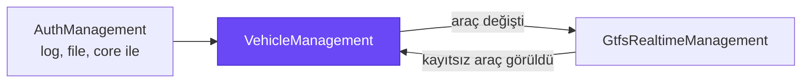
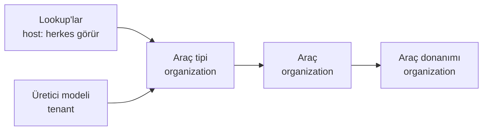
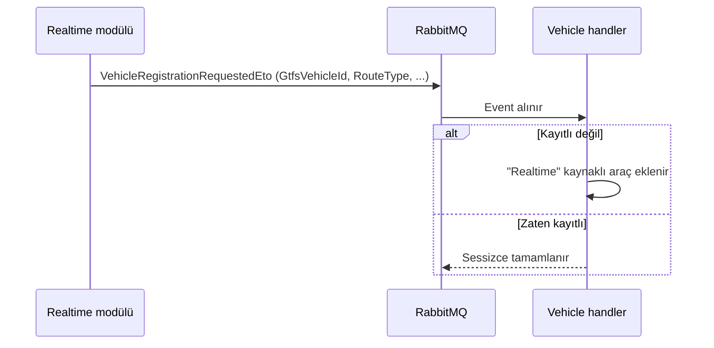

# Byd.VehicleManagement

Toplu taşıma filosunun modülü. Araç lookup'larını, üretici modellerini, araç tiplerini, araçları ve araç donanımlarını
yönetir. Araç kimliği GTFS-RT ile uyumludur: canlı akışta görülen ama kayıtlı olmayan araç otomatik eklenir.



## Capabilities

| Capability | Ne sağlar |
|---|---|
| [Filo yapısı](#filo-yapısı) | Lookup, model, tip, araç ve donanım; her biri doğru scope'ta |
| [Lookup yönetimi](#lookup-yönetimi) | Ulaşım modu, yakıt, durum gibi sabit listelerin tek tip yönetimi |
| [GTFS uyumlu araç kimliği](#gtfs-uyumlu-araç-kimliği) | Araç, canlı akıştaki kimliğiyle eşleşir |
| [Realtime'dan otomatik kayıt](#realtimedan-otomatik-kayıt) | Akışta görülen kayıtsız araç kendiliğinden eklenir |
| [Araç değişikliği event'i](#araç-değişikliği-eventi) | Araç eklenince, değişince, silinince diğer modüllere haber |
| [Cache'li araç listesi](#cacheli-araç-listesi) | Realtime eşlemesi her mesajda database'e gitmez |
| [Liste ve activity log](#liste-ve-activity-log) | Her kaynakta dynamic list query, update ve delete'te activity log |

## Filo yapısı



| Kayıt | Kim görür | Ne tutar |
|---|---|---|
| Lookup'lar | Herkes | Ulaşım modu, yakıt türü, araç durumu, erişilebilirlik, donanım türü, kayıt kaynağı |
| Üretici modeli | Tenant'taki herkes | Üretici ve model adı |
| Araç tipi | Kendi organization'ı | Kapasite (oturan, ayakta, tekerlekli sandalye, bisiklet), alçak taban, rampa, uzunluk |
| Araç | Kendi organization'ı | GTFS kimliği, etiket, plaka, hizmet aralığı |
| Araç donanımı | Kendi organization'ı | Aracın donanımları ve adetleri |

Organization scope'u token'dan gelir; organization seçmeden araç yazılamaz.

## Lookup yönetimi

Altı lookup tek bir base controller'dan aynı endpoint setini alır: create, get, list, update, delete. Her satır `Id`,
`Code` ve `Name` taşır; kod unique'tir. Ulaşım modunun kodu GTFS `route_type` ile aynıdır. Default satırlar host
açılışında seed edilir.

## GTFS uyumlu araç kimliği

Araç organization içinde işletmeci (`GtfsAgencyId`) ve GTFS-RT `vehicle.id` (`GtfsVehicleId`) ile tanınır. Canlı akış
aracı bu kimlikle bildirir, modül de aynı kimlikle eşler. Plaka unique sayılmaz, kaynaktaki haliyle tutulur.

## Realtime'dan otomatik kayıt

Realtime modülü akışta kayıtsız bir araç görürse `VehicleRegistrationRequestedEto` yayınlar. Vehicle modülünün handler'ı
aracı organization'ın listesinde arar; yoksa "Realtime" kaynaklı olarak ekler.



Aynı event'in tekrar gelmesi ikinci bir araç yazmaz. Handler'lar ayrı `Byd.VehicleManagement.Consumer` paketindedir;
modülü NuGet'ten alan bir host onları istemeden almaz.

## Araç değişikliği event'i

Araç eklendiğinde, güncellendiğinde ya da silindiğinde `VehicleEto` distributed event olarak yayınlanır. Realtime modülü
akıştaki GTFS-RT kimliğini araç kaydına bu event'le eşler.

## Cache'li araç listesi

Organization'ın araç listesi cache'te tutulur ve araç değişince temizlenir. Realtime akışı saniyeler içinde yüzlerce araç
bildirse de eşleme database'e gitmez.

## Liste ve activity log

Her kaynağın aynı endpoint seti vardır: create, get, `filtered-list`, update, delete. Liste core'un dynamic list query'sini
kullanır. Update ve delete işlemleri activity log'a düşer.

| Kaynak | Endpoint |
|---|---|
| Araçlar | `api/vehicle-management/vehicles` |
| Araç tipleri | `api/vehicle-management/vehicle-types` |
| Üretici modelleri | `api/vehicle-management/vehicle-models` |
| Araç donanımları | `api/vehicle-management/vehicle-equipments` |
| Lookup'lar | `api/vehicle-management/lookups/{transport-modes, fuel-types, ...}` |

Her kaynağın `View` ve `Manage` permission'ı vardır (`VehicleManagement.Vehicles.View` gibi).

## Modülde kullanım

Başka bir modül vehicle'ın event'lerini kullanacaksa `Byd.VehicleManagement.Domain.Shared` paketi yeter. Event'leri
işleyecek host `Byd.VehicleManagement.Consumer` paketini ekler. Host config'i: `ConnectionStrings:VehicleManagement`
(yoksa `Default`) ve RabbitMQ.

## Geliştirme

```bash
dotnet build Byd.VehicleManagement.slnx
dotnet test Byd.VehicleManagement.slnx
```
